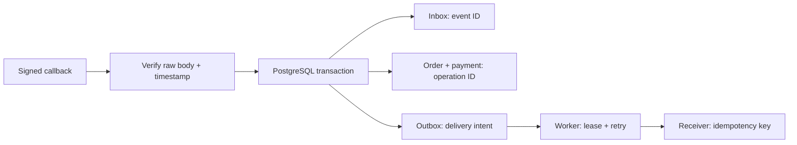

# Reliable payment webhooks

[](https://github.com/aistrategyc/reliable-webhook-lab/actions/workflows/ci.yml)

A payment succeeds. The provider sends the callback twice, and the notification
service is down. The order still needs to become paid once, with the notification
available for retry.

This repository implements that path with **FastAPI, PostgreSQL and a transactional
outbox**. It is an original reference example using a synthetic payment provider
and fake orders. The related commercial work is [WODAO](https://github.com/aistrategyc/aistrategyc/blob/main/cases/wodao.md);
its private source is separate.



## Run it

Requires Docker Compose and [uv](https://docs.astral.sh/uv/getting-started/installation/).
The default Python version is 3.11.

```sh
git clone https://github.com/aistrategyc/reliable-webhook-lab.git
cd reliable-webhook-lab
cp .env.example .env
set -a; . ./.env; set +a
docker compose up -d --wait
uv sync --locked
uv run lab demo
uv run pytest
```

On a fresh database, the demo reports:

```text
first callback          202 applied
same callback           202 duplicate_event
same payment, new event  202 duplicate_operation
receiver offline: failed
receiver recovered: delivered
payments: 1, outbox: 1, demo_deliveries: 1
```

The exact CLI output includes JSON response bodies. Running it again keeps the
same order and payment; already delivered work stays delivered.

To inspect the HTTP contract:

```sh
uv run uvicorn webhook_lab.api:from_env --factory --host 127.0.0.1 --port 8000
```

Open `http://127.0.0.1:8000/docs`. The endpoint accepts signed requests; the
[demo](src/webhook_lab/cli.py) shows how the synthetic signature is constructed.
It is not a Stripe-compatible signature adapter.

## Where the guarantees come from

| Decision | Implementation |
|---|---|
| Authenticate the exact payload | HMAC-SHA256 over timestamp + raw bytes, constant-time comparison, five-minute tolerance and 16 KiB body limit |
| Distinguish event replay from business duplication | `inbox.event_id` and `payments.operation_id` are separate unique keys |
| Keep payment and delivery intent consistent | Inbox, order, payment and outbox writes share one transaction |
| Handle simultaneous callbacks | Order row lock plus database constraints; eight concurrent callers are tested |
| Recover a worker crash | Expiring lease, `SKIP LOCKED` and a unique token for each claim |
| Prevent a late worker from acknowledging a new claim | Acknowledgement checks claim token and lease expiry |
| Stop endless retries | Five attempts, exponential delay, terminal `dead_at` state |

The delivery contract is **at least once**. A crash after the receiver commits but
before acknowledgement causes another send. The receiver must honour the operation
ID as an idempotency key. The synthetic receiver does; an arbitrary email provider
may not.

## Read the code in this order

1. [Payment transaction](src/webhook_lab/service.py) — the main business invariant.
2. [Tables and constraints](src/webhook_lab/sql/001_initial.sql).
3. [Worker](src/webhook_lab/worker.py) — claim, send, acknowledge, retry.
4. [Failure and concurrency tests](tests/test_webhooks.py).

Tests cover changed payloads under the same event ID, conflicting payment IDs,
unknown orders, invalid signatures, transaction rollback, concurrent callbacks,
concurrent workers, unavailable receivers, expired leases and retry exhaustion.
They use a real PostgreSQL database; each test owns a fresh schema.

[Design and failure analysis](docs/design.md) · [Operating notes](docs/operations.md)

## Scope

One successful payment per order, one currency per order, no partial payments,
refunds or chargebacks. A `409` needs retry or investigation according to the
reason; a real provider adapter must map this to its delivery contract. Workers
have no supervisor or scheduler here. The CLI processes one job at a time.

By [Kyrylo Prolieiev](https://github.com/aistrategyc) · [Engineering portfolio](https://proleev.com/en) · MIT
