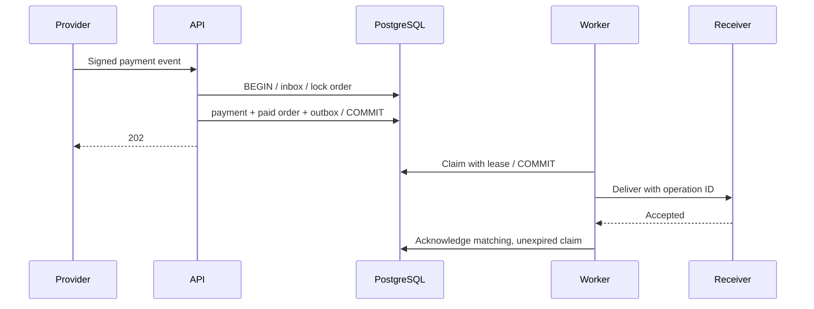

# Why an inbox and an outbox?

The inbox answers “have we accepted this provider event?” The payment table
answers “has this business operation been applied?” They cannot use the same key:
a provider may produce two event IDs about the same payment.

The handler first inserts the inbox record. PostgreSQL makes a competing insert
wait for the first transaction. If that transaction rolls back, the waiting
request can apply the event. If it commits, the waiting request compares the
body hash and acknowledges the replay.

The order lock serializes different event IDs for the same order. Database
uniqueness covers both one payment per order and one order per operation ID.
The outbox is inserted before commit. If that write fails, the order remains
pending and the inbox does not consume the event.

## The failure window cannot disappear

Database and receiver do not share a transaction. The worker deliberately releases
the database transaction before calling the receiver. Holding a row lock during
a network request would tie database capacity to provider latency.

If the receiver accepts and the worker crashes, the next worker sends again.
The test `test_crash_after_receiver_commit_is_safe_with_idempotent_receiver`
reproduces this window and checks that the receiver stores one delivery.

Leases do not cancel a slow remote call. The claim token fences database
acknowledgements; downstream idempotency handles duplicate external calls.
Real network adapters need a timeout shorter than the lease.

## What to observe

- Oldest undelivered outbox age and number of due jobs.
- Retry count, terminal failures and lost leases.
- Signature failures and business conflicts, grouped by reason.
- Payment acceptance latency separately from notification delivery latency.

The schema exposes these states. Exporters, alerting and dashboards are outside
this example. Do not log raw payment bodies or signing keys.

Dead letters require inspection before replay. The sample has no automatic
“reset attempts” operation: blindly retrying a permanently invalid request would
hide the cause.

## Trade-offs

PostgreSQL is enough for this bounded example, so there is no broker to provision.
At larger throughput, queue storage, polling cadence and retention need measurement.
The inbox compares exact bytes; semantically equivalent JSON under an already
used event ID is a conflict. This is intentional for the synthetic provider contract.
There is no key rotation, provider event retrieval or webhook allowlisting here.

The migration runner is additive and checksum-verified. It is not a complete
zero-downtime migration framework.
